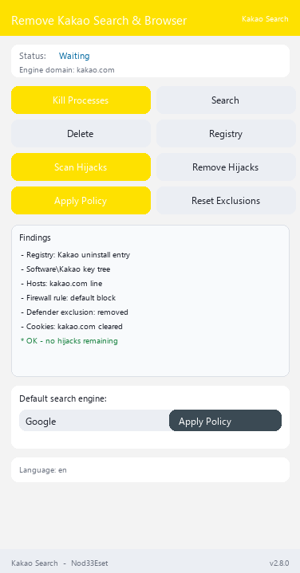

# AntiKakao Vanced

[](https://github.com/retvil/AntiKakaoVanced/releases) [](https://github.com/retvil/AntiKakaoVanced/releases) [](https://www.python.org/)

**Remove Kakao Browser completely and lock your default search against hijacking — 28 detection vectors (VANCED) / 39 detection vectors (EXTENDED), 10 search engines, 10 UI languages.**

**🇬🇧 English** | [🇷🇺 Русский](docs/lang_icons/ru.png) | ...

## What is this?

Kakao doesn't just install a browser — it quietly registers itself as the default search and browser through multiple system mechanisms: registry associations, enterprise policies, per-profile browser settings, even search-engine databases inside Chromium profiles. Removing the browser alone doesn't undo all of that.

**AntiKakao Vanced** (a fork of [TheCawa/AntiYandex](https://github.com/TheCawa/AntiYandex)) finds **all hijack vectors** (28 in VANCED, 39 in EXTENDED), removes them with one click, and then **hard-locks your default search** to an engine of your choice via Windows enterprise policies — so nothing can silently take it back.

## Features

- **Hijack scanner** — detects 28 vectors (VANCED) / 39 vectors (EXTENDED): install paths, uninstall registry entries, `UserChoice` default-browser association, `StartMenuInternet` registrations, `Software\Kakao` key trees, `DefaultSearchProvider*` policy hijack, Chromium profile `Preferences`, `Web Data` SQLite keywords, Firefox `search.json.mozlz4`, legacy `SearchScopes`, autostart entries, scheduled tasks, Windows services, IME Switcher, file associations, Kakao Disk shell integration, disabled autostart, App Paths, shortcuts, ProgramData/Roaming leftovers, hosts entries, firewall rules, URI protocols, browser extensions, kakao.ru cookies, open-with associations, Prefetch/WER traces, Defender exclusions, keyboard layouts, IE Start Page hijack, startup-URL policies (`RestoreOnStartupURLs`), Firefox homepage, IE zone map, RegisteredApplications entries, MUICache traces, %TEMP% installers, Store apps (Kakao Music), product directories, local data directories, Kakao.DNS
- **One-click removal** — every detected vector is removed with a dedicated remover; locked databases are reported, never crash
- **Hard search policy** — locks the default search to one of 10 engines (Google, Bing, DuckDuckGo, Brave Search, Startpage, Mojeek, Qwant, Ecosia, Yahoo, SearXNG) via HKLM policies for Chrome, Edge, Brave, Vivaldi, Opera and Kakao Browser, plus `policies.json` for Firefox/Waterfox
- **Policy cleanup** — strips Kakao `DefaultSearchProvider*` values from the registry
- **10 UI languages** — ru, en, uk, kk, de, fr, es, pl, tr, zh; system language auto-detected
- **Light UI** — ttkbootstrap, vertical layout, pinned status bar and footer

## Screenshot

<details>
<summary>Main window</summary>



</details>

## Ready builds

Download from [Releases](https://github.com/retvil/AntiKakaoVanced/releases):

- **Windows** — `AntiKakaoVanced.exe` (portable, single file, ~35 MB) — removes Kakao Browser and Kakao Search
- **Windows** — `AntiKakaoExtended.exe` (portable, single file, ~35 MB) — removal of every Kakao product (Kakao Disk, IME Switcher history, system-wide traces, Store apps, Kakao.DNS)

Run it **as administrator** — HKLM policies and registry cleanup require elevated rights.

## Install from source

Requires Python 3.10+ ([python.org](https://python.org)).

```bash
git clone https://github.com/retvil/AntiKakaoVanced.git
cd AntiKakaoVanced
pip install psutil ttkbootstrap
python main.py
```

Build your own EXE: run `build.bat` (PyInstaller, output in `dist/`).

## Usage

1. **Kill Processes** → **Search Kakao** → **Delete Kakao** — remove the browser itself.
2. **Scan Search Hijacks** — lists every way Kakao hooked into your system.
3. **Remove Hijacks** — close all browsers first, then remove everything found.
4. Pick an engine → **Apply Policy** — your default search is now locked system-wide.

## FAQ

- **Why administrator?** Default-search policies live in HKLM and hijack cleanup touches system registry — both need elevation.
- **"Database locked" in results?** A Chromium browser was running during cleanup. Close all browsers and run the removal again.
- **How do I undo the search policy?** The **Remove Kakao Policies** button strips the policy values; Firefox users can also delete the `distribution\policies.json` file.

## Author & support

**Nod33Eset** — fork of [TheCawa/AntiYandex](https://github.com/TheCawa/AntiYandex). Issues and PRs are welcome.

If the tool saved you from Kakao, you can support development:

**Crypto:**

- BTC: `bc1qunld3rsp37qf5gg69aune50y0qqkd0eugg7j97`
- TON: `UQDmvr4SKOxSION3Yky6aOgzAnCDXySPuAbG4EKJa5JUT7tC`
- USDT (TRC20): `TBPJSSLu1mUcX54g9UyxUohYGf2fuRvbwd`
- USDT (ERC20): `0x25CAED3776Ef5b18E03392bC5b254Bbd78E8180C`
- USDT (SOL): `3qgN5z291CEcj2FUi2Zza5DioxKgNw72kC7P52pCcTrG`

## License

MIT — see [LICENSE](LICENSE).


